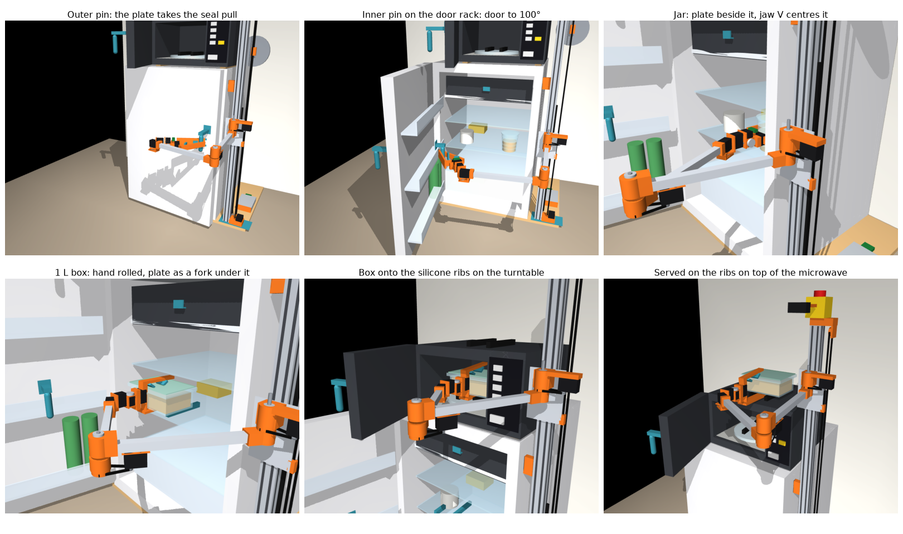
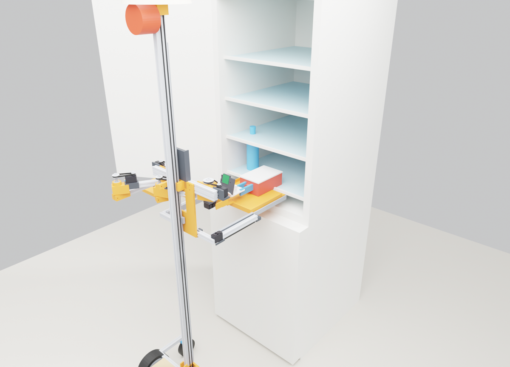

# Tischlein

Tischlein is a low-cost assistive robotics project for people who spend much of the day in bed. The aim is to fetch food, drinks and small objects around the home. This repository contains CAD, MuJoCo simulations and a household task benchmark. Nothing has been built yet; all reported results are from simulation. The next step is a hardware prototype.

## What is here

**[Build11, a fridge-to-microwave breakfast cell](designs/breakfast-cell/build11/README.md).** A fixed arm on a lift opens a fridge, takes a jar or a glass box to the microwave, heats it and serves it. Printed door pins and a fork-and-V-jaw hand do the work; doors swing free on their hinges with seals and catches, and servos have real torque limits, lag and calibration errors. In simulation 106 of 120 randomised mornings complete, and 110 of 120 with calibrated joints. The camera errors are assumed values: no vision model is run. The folder holds the model, the simulation code, the parts list, print-fit files and an interactive 3D viewer.

[](designs/breakfast-cell/build11/README.md)

**[Arena](arena/README.md), a household simulation benchmark.** A fixed MuJoCo flat with a person in bed, eight parameterised homes and a physics-checked judge. Robots are data entries; the jobs are complete: find an object, grasp it, carry it and release it on the right support, with the fridge shut again and the microwave sequence included. Tests, protocol ([FULL_JOBS.md](arena/FULL_JOBS.md)) and a reference controller are included.

**[Original mobile design, v0.2 and v0.3](docs/orthodox-design.md).** A mobile base with a lift, a drawer tray and flat SCARA arms with a CAP gripper: parametric CAD, print files, MuJoCo models, closed-form checks, and the door, jar and transfer simulations behind it.

| [](docs/orthodox-design.md) |
|:---:|
| Original mobile design: a box moves from the fridge onto the drawer tray. |

Also here: [pretrained-skill experiments](experiments/cap_zero_shot/README.md) that run the open CAP policies on this robot's kinematics in EgoGym.

## Run it

Python 3.13+ and [uv](https://docs.astral.sh/uv/), from the repository root:

```sh
uv sync --locked
uv run python -m http.server 8767 --bind 127.0.0.1 --directory designs/breakfast-cell/build11
```

Open [the interactive 3D model](http://127.0.0.1:8767/viewer.html): orbit, play the morning as planned or in physics, switch fridge and meal, click a part for its parts-list line, read the checks. The viewer loads three.js from a CDN. The build11 README lists the commands that reproduce every result.

The arena's tests and a first complete job:

```sh
uv run python -m arena.tests.test_v2
uv run python -m arena.tests.test_physics
uv run python -m arena.jobs --robots revolution_low --scenarios floor_remote --homes A --seeds 1 --seed-offset 0 --workers 1
```

The original design's checks, CAD, MuJoCo model and fridge-to-bed demo:

```sh
uv run python calc.py && uv run python cad/build.py && uv run python sim/build_mjcf.py && uv run python sim/demo.py
```

## Next

A mobile fetcher with learned control is in development.

## Licence

No project licence is granted; all rights are reserved. The exception is [vendor/so-arm100](vendor/so-arm100/README.md), which is third-party material under its own Apache 2.0 licence.
