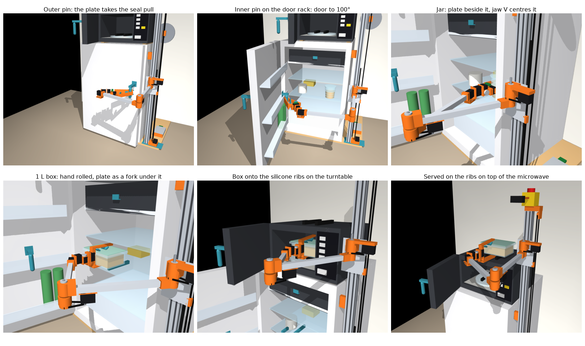

# Build11: a fridge-to-microwave breakfast cell, tested in physics

A fixed arm on a lift stands beside a fridge and a microwave. It opens the fridge, takes a glass jar or a 1 L glass box out, carries it to the microwave, heats it and serves it on top of the microwave. Doors and keys are worked through printed pins stuck to the appliances with tape (nothing is drilled), and the meal is carried by a fork or a V-jaw hand. Nothing has been built: all results below come from MuJoCo simulation, and the hardware build is next.

**[Interactive 3D model](viewer.html).** Serve this folder over HTTP to open it in a browser (commands below). Pick the jar or the 1 L box and the 90 or 50 cm fridge. Play the planned morning or the same morning run in physics. Click any part for its parts-list line. The Checks tab has every result below.



## The design

- **Arm and lift.** Seven bus servos: a belt-driven lift on a 40 × 40 mm V-slot mast with a 1.25 kg counterweight (the lift holds when power is cut), shoulder and elbow through 3:1 belts on two 350 mm links, then wrist yaw (STS3250), roll, pitch and the gripper servo. A wrist camera and a fixed scene camera.
- **One hand for everything.** The fixed finger is a flat printed plate (146 × 44 × 8 mm). It is the side of a jar grip and, with the hand rolled −90°, a fork under boxes. The moving jaw carries the V pad that centres the jar. Two 8 mm nubs at the plate's tip press the microwave keys.
- **Door pins.** Printed pins stuck to the fridge door (an outer pin, and an inner pin on the door rack for the last part of the swing) and to the microwave door. The hand rises with the pin centred in the open jaw and closes to a cage round it, so the rigid plate takes the force.
- **Cell aids.** Printed rails under the 1 L boxes (20 mm, 80 mm apart), silicone ribs on the turntable and on the serving spot that the fork runs between, a smart plug that caps the heating time whatever keys are pressed.
- **Appliances.** A 60 × 60 × 90 cm fridge with a freezer compartment, a 47 × 47 × 50 cm fridge, and a 44.5 × 36 × 26 cm microwave. The jar is a 580 ml tapered Weck jar; the box is 21 × 15 × 7.5 cm.

The parts list is [bom.csv](bom.csv). The model starts from build10's ([model3d.py](../build10/model3d.py), [sequence.py](../build10/sequence.py)).

## What the simulation checks

- **Planned mornings**, at the servos' real speeds, with every frame checked in MuJoCo's collision detector: 3 mm between the robot and everything, itself included. The held meal may touch only what it rests on.
- **Whole mornings in physics**, closed loop. Gravity, servo torque limits, lag and calibration error are on. Doors swing free on their hinges with seals and catches, and the turntable turns at its real 5 rpm. The robot looks before each step and plans on from what it sees (door pins to 2 mm, the meal to 2 mm and 1°).
- **Random mornings.** Each draws the fridge seal (10–25 N at the pin), the microwave catch (8–20 N), door weights and hinge friction, servo stiffness (60–100%), joint zero errors (0.3° and 0.5 mm), the meal's weight and friction (wet glass), where it stands (±10 mm), the turntable's stop angle (±8°) and the camera errors. The same 30 draws go to every menu and every row, so rows compare like with like.

## Results

| | 90 cm fridge, jar | 90 cm fridge, 1 L box | 50 cm fridge, jar | 50 cm fridge, 1 L box |
|---|---:|---:|---:|---:|
| Planned morning, robot time without heating ([plan11.py](plan11.py)) | 4:41 | 4:42 | 4:45 | 4:47 |
| Frames with any collision in the plan | 0 | 0 | 0 | 0 |
| Spots it can take the meal from, fridge door at 100° | 73% | 88% | 71% | 80% |
| Taking and serving in physics, with placement and camera errors ([dyn11.py](dyn11.py)) | 30/30 | 30/30 | 30/30 | 30/30 |
| Whole random mornings in physics, stock wrist yaw ([doors11.py](doors11.py)) | 16/30 | 15/30 | 13/30 | 13/30 |
| … with the STS3250 on the wrist yaw | 26/30 | 27/30 | 26/30 | 27/30 |
| … and joints calibrated to 0.15° | 28/30 | 28/30 | 27/30 | 27/30 |

With the STS3250, 106 of 120 random mornings complete, and 110 of 120 with calibrated joints. Every morning with a seal under 23 N completes (84 of 84). Across the 360 random mornings in the table no meal reached the floor; one jar tipped over inside the microwave on a morning with a calibration error. A seal the arm cannot break leaves the door shut and the robot stopped, so nothing breaks.

## What the physics changed

Whole-morning physics checks exposed a collision-filter gap in the planner. Fixing it led to the changes below.

| Found | Change |
|---|---|
| **The planner let fingers pass through door pins, keys and tabs.** In build10's collision classes the finger class never meets handles or the robot's own links. That was fine for build10's short fingers; build11's 146 mm plate went straight through pins. | Fingers now meet pins, keys, tabs and robot links. Touching is allowed only for the one pin or key in use, and only while using it. |
| Rising onto a pin, the plate was planned exactly touching it | The hand rises with the pin centred in the open jaw (6 mm each side), slides the plate onto it, then closes. Grips that leave that room are preferred. |
| Squeezing the pin at full jaw torque fixed it where the plan didn't expect, and the arm fought the hinge (3–8 s of stalled wrist pitch per morning) | The jaw closes to its planned angle at normal torque: a cage round the pin. The rigid plate takes the force. |
| Closing, the jaw pushed the microwave door into its catch and gave way above about 13 N | The plate pushes the last 5° of every close, as it pulls the first 5° of every open. |
| Smoothing each joint separately cut corners by about 1 cm | The servo goals follow the planned path itself, stop at sharp bends, and lead each servo by its lag. Free moves now track the plan to 0.6 mm. |
| A carried box grazed the open microwave door, and the hand ran 4.5 mm from a door it was pushing | A carried meal keeps 3 mm from everything but where it is set down. The hand keeps 8 mm from a door it is going for or moving. |
| The plate's top edge caught a pin's flat bottom end and tipped the wrist 6–9° | Pins have domed ends. |
| The 4 mm side gap at the jar let calibration errors push jars to the fingertips (2 drops in 6 trials) | 8 mm side gap: the jaw closes the rest. |
| Doors end up a few degrees off where the hand left them, and the next grasp missed | Closed loop: before every step and every door grasp the robot looks and plans on from what it sees. It waits for a swinging door to settle, and re-grips a door that ended more than 1° off. |
| Door arcs only planned from exact angles (100.0° worked, 100.3° didn't) | Door angles snap to a fixed 2° grid after the first. |
| Put-downs into the microwave assumed the turntable's ribs at home | The fork follows the rib channel it sees, for the put-down as for the hot take. |
| Heating spun the turntable at display speed and the meal flew off | 5 rpm, with the motor's gearbox inertia. A jar on the two ribs then stays within 1 mm. |
| The 50 cm fridge's seal was simulated at the 90 cm door's lever | Seal force is the straight pull at the pin on both fridges. |
| **The stock wrist yaw stalls on the fridge seal.** The plate pushes the pin square to the hand, about 17 cm out from the yaw axis, so the yaw servo carries the whole seal: it stops at about 17 N at the pin. That alone failed about half of the random mornings. | The wrist yaw is an STS3250 (same case and bus). It breaks seals up to about 23 N with random errors. |
| After letting go of the inner pin, the robot only looked at the fridge door once its arm was out past the door's edge. A door that stopped 2° short of the plan stood in the way. | It looks right after letting go, takes the pin again if the door is 2° or more off, and plans the way out from the door it sees. If the hand is still wedged, it pushes the door 2–4° further open first. |
| A box turned to match a rib channel that had stopped 5° off caught the open microwave door with a corner | The box goes in straight and turns over the last 4 cm, inside the microwave. |
| Correcting a door at the pin's reach limit (63° of 64°) found no grasp and stopped the morning | The robot carries on from the door as it sees it; the next step plans from there. |

## The fridge seal

Seal sweep: the jar morning on the 90 cm fridge with everything else nominal, at rising seal forces (`doors11.py --sweep`):

| Seal at the pin, N | 10 | 14 | 17.5 | 20 | 23 | 26 | 29 | 32 |
|---|---|---|---|---|---|---|---|---|
| Stock STS3215 yaw | opens | opens | opens | opens, yaw stalls | stuck | stuck | stuck | stuck |
| STS3250 yaw | opens | opens | opens | opens | opens | opens | opens | stuck |

With random errors the STS3250 has less margin: it failed at 23.6 and 24.5 N, but passed at 24.4–24.9 N in other draws. Seal forces of small fridges are not published, so the robot is meant to measure the seal by pulling on the pin while reading the yaw servo's load, and to stop before the stall.

With the STS3250, 14 of 120 mornings fail. Eight are seals of 23.6 or 24.5 N, where the yaw stalls and the door stays shut. Six are joint zero errors of 0.5–0.6° (about 1 cm at the hand) that make a door step or the hot take miss. In the calibrated batch no failure of the second kind remains; its 10 failures are all seals of 23.2–24.5 N. The jar's wrist pitch averages 108% of its rated torque for about 30 s while carrying the jar, the box's fork only 6%.

## Limits of the model

- Wet or frosted glass beyond the friction ranges drawn, food sloshing and a lid sliding off.
- Belt stretch and gear backlash other than as calibration error; servo heating over many mornings.
- Real fridges, microwaves and boxes: sizes are assumed.
- The camera itself: the closed-loop tests give the robot the door angles and the meal pose with camera-sized errors; they do not run a vision model.
- Seals above about 23 N at the pin. A peel lever that would take over there is not simulated.
- The freezer compartment's flap. With the fridge door shut the door racks leave 10 mm in front of the flap, and this hand's nubs need 3 mm clearance along the hand, so they cannot hook a tab that fits there. The frozen-meal tray menu (`tray_large` in `plan11.py`) does not plan (`flap_open: cannot reach above the flap tab`) and is not part of the results.
- The inner door pin stands 4 cm into the fridge when the door is shut. The front of the middle shelf must stay clear in a band about 12 cm wide, 25 cm from the hinge.

## Files

| File | What |
|---|---|
| [model11.py](model11.py) | Build11 on build10's model: the hand, bearings, pins, freezer, rails and ribs; kinematic and dynamic MuJoCo models |
| [plan11.py](plan11.py) | Whole mornings planned at servo speed and collision-checked; shelf coverage → `plan11.json`, `plan11-results.json` |
| [doors11.py](doors11.py) | Whole mornings in physics, open- or closed-loop, random trials, the seal sweep → `doors11-results.json` |
| [dyn11.py](dyn11.py) | Taking and serving the meal in physics with placement and camera errors → `dyn11-results.json` |
| [senses11.py](senses11.py), [SENSES.md](SENSES.md) | Letting go of the meal by feeling the touchdown → `senses11-results.json`, `senses11-sweep.json` |
| [viewer11.py](viewer11.py), [viewer_template.html](viewer_template.html) | The interactive model → `viewer.html` |
| [stills11.py](stills11.py) | `render-mornings.png` |
| [bom.csv](bom.csv) | The parts list |
| [print/](print/README.md) | Print-fit kit and door pins |
| [../build10/](../build10) | `model3d.py` and `sequence.py`, the base model and kinematic morning that build11 imports |

Python 3.13 and [uv](https://docs.astral.sh/uv/), from the repository root:

```bash
uv sync --locked
uv run python -m http.server 8767 --bind 127.0.0.1 --directory designs/breakfast-cell/build11   # then open http://127.0.0.1:8767/viewer.html
```
```bash
uv run python designs/breakfast-cell/build11/plan11.py
```
```bash
uv run python designs/breakfast-cell/build11/doors11.py 30
```
```bash
uv run python designs/breakfast-cell/build11/doors11.py 30 --yaw sts3250
```
```bash
uv run python designs/breakfast-cell/build11/doors11.py 30 --yaw sts3250 --cal 0.5
```
```bash
uv run python designs/breakfast-cell/build11/doors11.py --sweep
```
```bash
uv run python designs/breakfast-cell/build11/dyn11.py 30
```
```bash
uv run python designs/breakfast-cell/build11/viewer11.py
```

`plan11.py` rewrites `plan11.json`; the other scripts read it, so run it first. `viewer11.py` rebuilds `viewer.html` from the three result files in about half a minute.
