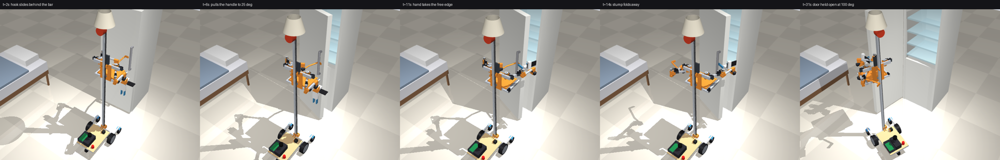

# A hand and a stump instead of two hands

One full hand and a simple "stump": like a person born with one arm who does almost everything with one skilled hand and a forearm that holds, presses and hooks. This page tests four archetypes in the fridge-door simulation and checks the other jobs a second arm does.

## Short answer

- **A hand and a stump with one wrist servo** matches two full hands on every door in the door simulation and opens strong seals that the full hands can't. It needs no gripper, phone or camera.
- **A stump without any wrist servo is not enough.**
  - A rigid hook opens all doors with ordinary seals, but it can't be turned. Holding a door's edge or squaring a floor scoop would then need base moves a diff-drive can't make (reasoned, not simulated).
  - A free or sprung swivel loses the handle in every run.
- **What the stump can't do:** two-handed dexterous work (folding, opening packaging). Nothing pretrained exists for that.

## The four archetypes

All four keep the right arm as it is: flat arm, wrist yaw, pitch and roll, CAP gripper, wrist camera. They differ in the left arm.

| | Left arm | Servos |
|---|---|---|
| **One arm** | none | 0 |
| **Two full hands** | the same as the right arm | 5 + XL330 |
| **Rigid stump** | shoulder and elbow, a printed hook fixed to the forearm | 2 |
| **Stump + yaw** | shoulder, elbow and one wrist yaw servo turning a printed tool head (hook, pad, fork) | 3 |
| (Swivel stump) | shoulder and elbow, the hook on a free bearing with a weak return spring | 2 |

The stump uses the arm-B hardware of `bom.csv` without the STS3250, XL330, CAP hardware and phone.

**The hook** (`sim/fridge_door.py`, `stump_geoms_xml`) hangs from the wrist at the height where the hand's pads would be. A shank passes beside the handle bar, and a 10 mm tip sits in the 22 mm gap behind it. The hook slides in sideways from the hinge side, then pulls. No squeeze, no friction grip.

## Fridge door: the simulation

Setup:
- The same sweep as for one vs two arms: `sim/fridge_door.py`, real joint speeds, the robot's own collision shapes.
- 2 doors (fridge-freezer, tall) × 3 closing behaviours (stays open above 25°, closes from 60°, always closes) × 3 seals (15/35/55 N at the handle) × 3 floors (μ 0.4/0.6/0.8) = 54 runs per archetype.
- The left arm holds the handle at 25° while the right hand takes the free edge, as with two hands.

| Archetype | All 54 | Doors that stay open (18) | Self-closing doors (36) | Seals ≤ 35 N (36) | 55 N seals (18) |
|---|---:|---:|---:|---:|---:|
| One arm | 12 | 12 | **0** | 12 | 0 |
| Two full hands | 36 | 12 | 24 | **36** | 0 |
| Rigid stump | 42 | 14 | 28 | **36** | 6 |
| **Stump + yaw** | **54** | 18 | 36 | **36** | **18** (6 doubtful) |
| Swivel stump | 0 of 6 quick runs | | | | |

(Files: `out/fridge_door_sweep.txt` for one and two arms, `out/fridge_door_stumprigid_sweep.txt`, `out/fridge_door_stump_sweep.txt`, `out/fridge_door_stump_quick.txt`.)

(`uv run python sim/fridge_door.py --video stumpyaw full always 35 0.6`.)

What it says:
- **With ordinary seals, any left arm that can hold the handle does the job.** Rigid stump, stump + yaw and two hands all get 36/36. One arm stays at 12 (no self-closing door).
- **A hook beats a hand on strong seals.**
  - The CAP hand's grip slips at 55 N: 0/18, as on 26 Oct.
  - A hook can't slip. The yaw stump opened all 18 strong-seal runs, the rigid one 6.
  - **Doubtful:** the six yaw-stump wins on the slippery floor (μ 0.4). There the wheels give only ~46 N, and in every 55 N run some robot shape pressed on the door or fridge with 190–275 N. That is the hook wedging behind the bar, or the robot bracing against the cabinet. Count those six as unproven.
- **The rigid stump's weakness is its heading.**
  - Without a wrist, the hook's direction follows the shoulder and elbow. Over the 25° pull it drifts ±13–16° from square to the door.
  - It still opened every door with an ordinary seal, with 50–74 N of rubbing contact (vs 12–21 N with yaw).
- **The swivel stump failed every run (the door reached 14–17° and fell shut).**
  - A free swivel can only pull along the line through its bearing. The hook must turn ~25–30° with the door, and the planned elbow path can't direct the pull that way.
  - A return spring of 3–30 N·m/rad didn't help (door to 8–12°). Its rest angle is fixed, so it fights the turn the hook must make.
  - A first version also showed the hook's geometry matters: with the corner 4 cm off the swivel's axis, the bar walked along the tip and off its open end. The corner now sits on the axis, for every archetype.

## The other jobs a second arm does

| Job | One arm | Two full hands | Rigid stump | Stump + yaw | Evidence |
|---|---|---|---|---|---|
| Open a self-closing fridge door | no | yes | yes (≤ 35 N seals) | yes | sim, above |
| **Hold a self-closing door while the hand fetches** | no | yes: the left hand hooks the edge at 95–105° | unlikely: it can't turn the hook square to the edge | same geometry as the left hand: same links and tool length, plus a fork face on the head | geometric for two hands ([two-arms.md](two-arms.md)); not simulated for the stump |
| **Thin things off the floor (scoop)** | needs a scoop plate somewhere else (the drawer stops 7.5 cm above the floor) | one hand holds a scoop tool | heading follows the arm: uncertain | **the scoop in `sim/floor_pick.py` moves in x, y, yaw and height only, exactly what this stump can do** (99 % vs 75 % for a grasp) | sim with a free scoop; the robot version is a hook-on scoop plate with a sprung foot |
| Screw-top jar | clamp on the tray (≤ 1 N·m) | the holding hand slips like the twisting one (≤ 0.6 N·m) | pad presses the jar into a V-block on the tray: like the clamp | same | `sim/jar.py`; stump not simulated |
| Carry a bag or caddy by its handle | tray only | in the hand | on the hook: the flat arm's bearings carry it, no servo torque | same | statics |
| Two-handed dexterous work | no | with own demonstrations | no | no | not in v1 |

The stump's head therefore has four faces: **hook** (handle bars, drawer pulls, caddy handles), **fork** (a door's free edge), **pad** (push, press, steady) and a **loop** to carry a scoop plate stored on the base. A suction cup is optional; the scoop already handles thin things on the floor.

## Conclusions and next simulations

- **Hand + stump with a yaw servo** gives the same door results as two hands and better results on strong seals. It has the same reach and tool length as the hand, so the door-hold geometry carries over, and it is the scoop holder the floor simulation assumed. It is lighter than a second full arm (no STS3250, XL330, gripper or phone).
- **A second full arm** stays an option for two-handed skills. The shoulder and elbow are the same, so swapping is a wrist change.
- **Next in simulation:**
  - The stump holding the edge of an always-closing door while the hand fetches from the lower shelf, in physics, not only geometry.
  - The learned door policy (`sim/door_policy.py`) with the stump: two full hands got 82 % learned against 97 % scripted.
- **On the bench:** a real fridge handle and its gap. Ours is 22 mm behind a 30 mm bar, and real handles vary. Also how hard the hook presses the door while breaking a strong seal.

## Limits

- Scripted motions, no perception error beyond the planner's; one handle shape.
- MuJoCo's soft contacts. The 190–275 N contact peaks with 55 N seals are unexplained, which is why those wins are marked.
- The tool head's fork, pad and scoop loop are drawn in words, not in CAD.
- Nothing has been built.
