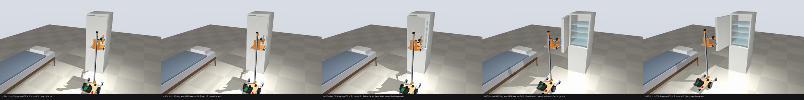
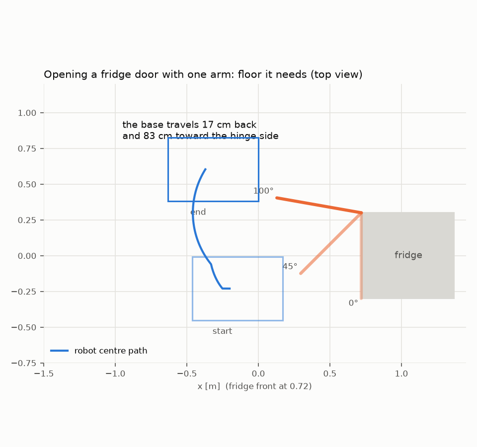

# Fridge door: what the simulation says and what to measure on a real fridge

## Simulation at real speeds, with collisions and a tall door

`sim/fridge_door.py`, sweep `out/fridge_door_sweep.txt`, videos via `--video`. An earlier simulation of the same strategies had three faults that this one fixes:
- its re-grasp dropped the lift 26 cm in 0.7 s (at the design's 6 cm/s that takes ~4.3 s);
- the robot had no collision shapes;
- its only door started 0.885 m above the floor, so the base could drive under it.

**What the new sim has:**
- **Real speeds:** every joint at its real speed (lift 6 cm/s, shoulder 60°/s, elbow 90°/s, wrist 150–180°/s), enforced by a rate limiter that reports any lag.
- **Collision shapes** for the base, legs, wheels, mast, carriage, face, tray and both arms' links.
- **Two doors:** a fridge-freezer upper door (from 0.885 m up) and a tall single door (from 4 cm up: nothing can pass under it).
- **Three self-closing behaviours:**
  - closes itself only below 25°, else stays put, hold-open beyond 92°;
  - closes itself from anywhere below 60°;
  - always closes itself, no hold-open (self-closing hinges).
- **Two strategies:**
  - **One arm:** grip the handle, back off (seal), pull the handle to ~35°, let go, swing the hand round to beyond the free edge, hook the edge, pull it round while the base reverses and turns.
  - **Two arms:** the left hand does the handle and *keeps holding* while the right hand hooks the free edge; then the left hand lets go and tucks, and the right pulls the edge round.

**Result** (9 runs per cell: seal 15/35/55 N × floor μ 0.4/0.6/0.8):

| Door closes itself… | One arm, fridge-freezer door | One arm, tall door | Two arms, fridge-freezer door | Two arms, tall door |
|---|---:|---:|---:|---:|
| only below 25° | 6/9 | 6/9 | 6/9 | 6/9 |
| below 60° | **0/9** | **0/9** | 6/9 | 6/9 |
| always (no hold-open) | **0/9** | **0/9** | 6/9, **held open** | 6/9, **held open** |

The 3 failures in every successful cell are the 55 N seal.

What it says:
- **One arm needs seconds to get from the handle to the free edge; a self-closing door needs ~1.3 s to shut.**
  - The scripted re-grasp takes ~14 s with conservative timing; even perfectly timed it's ≥ ~4 s. The shoulder alone swings ~100° at ~60°/s through its 3:1 belt, and the hand must go round the edge with ≥3 cm to spare (the hand is 28 cm long, and the phone sticks out 11.5 cm sideways).
  - A door that closes itself from 35° (1 N·m, 8 kg) is shut ~1.3 s after release.
  - The handle can't be pulled further than ~40–45° from the robot's side: past that the robot runs into the door (tried 50° and 65°).
  - **So one arm works only for doors that stay put above ~35°.**
- **Two arms remove the race:** one hand always holds the door. They open all three kinds, and for doors without hold-open the second hand is still free when the door is fully open.
  - Two lessons came with it:
    - both arms move in the same horizontal planes, so they can't cross; the idle arm must tuck along its side of the carriage (upper arm back, forearm forward), not park in front;
    - the right hand hooks the edge while the left still holds the handle (left hand on the left object, right on the right).
- **The seal limit is now the arm, not the wheels:**
  - ≤ 45 N opens, 50–55 N doesn't: the hand on the handle can't transmit more.
  - The v0.2 robot weighs 15.8 kg with ~75% on the drive wheels: 47 / 70 / 93 N of traction at μ 0.4 / 0.6 / 0.8.
- **The wrist yaw servo is the busiest joint** when pulling the edge: the 28 cm hand is a lever. It touches its limit for ~1–2 s on the 10 kg tall door. If door pulls become routine, an STS3250 on the wrist yaw adds margin.

**What to measure on a real fridge (5 minutes):**
1. Luggage scale at the handle: the peak pull (≤ ~45 N works).
2. The bottom edge of the door: fridge-freezer or tall door (both work now).
3. **Open it to 30°, 45° and 60° and let go: does it close itself?** If it stays put above ~35°, one arm can do it. Otherwise it needs a second arm or a stump ([asymmetric-arms.md](asymmetric-arms.md)), or the opener below.

## Holding the handle all the way

Sim: `sim/door.py`. Figures: `out/door_strip.png`, `out/door_space.png`. Video: `sim/door.py --video` (not in git).

A fridge door is two different problems.

**1. Breaking the seal.** This is the only part that needs force.
- Door seals hold mostly through the magnet strip, plus slight suction once the air inside has cooled.
- A US safety rule requires a closed fridge to open from the inside with ≤ 66.7 N ([16 CFR 1750](https://www.govinfo.gov/content/pkg/CFR-2015-title16-vol2/pdf/CFR-2015-title16-vol2-chapII-subchapF.pdf)). That's a child-safety rule, not a handle measurement.
- No measured handle forces for real fridges are published, so measure with a luggage scale.

**2. Swinging it past the hold-open point and keeping it open.** Almost no force, but geometry. The handle moves on a 55 cm arc, many doors close themselves below ~90°, and a robot standing in front is in the way of its own door.

A hinged door with a magnetic-seal model in the simulation tests the plain strategy, with no fridge modification:
1. Grip the handle with the arm almost straight, so the pull runs through the bearings and not the servos.
2. Back the base off 5 cm.
3. Follow the arc.

| | Result |
|---|---|
| Seal breaks | whenever the seal is weaker than the wheels' grip: ~30 N on a slippery floor (μ 0.4), ~45 N normal, ~60 N grippy |
| Door ends at 100°, past the hold-open point | yes, in every run where the seal broke |
| Arm load during the swing | 10–40% of the servo limits (one slip case peaked higher) |
| **Catch 1: space** | the base travels 17 cm back and **83 cm sideways toward the hinge side**. You need that free floor next to the fridge |
| **Catch 2: two wheels** | the sim base slides sideways; a two-wheel base can't. It has to turn and drive in small steps while the arm compensates. Solvable in software, untested |
| Without the extra floor | the door gets to ~56° and then closes itself again when released |

Video: regenerate with `sim/door.py --video` (not in git).

**What to do with a real fridge, in this order:**

1. **Measure** the peak force at the handle with a luggage scale, and the free floor beside the hinge. Five minutes, decides everything.
2. **If the seal is ≤ ~40 N and there is space:** the general-purpose robot does it. No changes.
3. **If there is no space:** use the free-edge strategy above, which needs floor behind the robot rather than beside it, with a second arm or a stump. One hand holds the handle at ~50° so the door can't swing shut; the other reaches in and pushes the door from inside past 90°.
4. **If the seal is too strong:** a small removable opener on the cabinet: a 12 V mini linear actuator or a servo with a cam, stuck to the cabinet top or side with VHB tape and triggered by the robot over Wi-Fi via an ESP32. After that the robot only does the easy part.
5. **A purely passive lever** (pry finger in the gap at the free edge, the robot pushes a long arm) works on paper with ~8:1 leverage, but depends much more on the fridge model.

General-purpose manipulation comes first; a bespoke opener is for a specific fridge that forces it. The measurement in step 1 tells which case applies.
