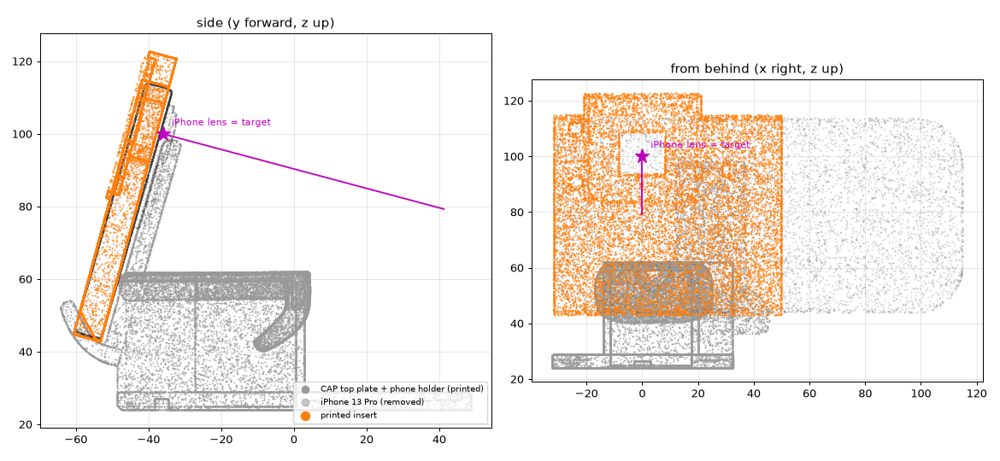

# An infrared camera instead of the phone

Can a small infrared camera with a printed mount replace the phone on the hand, and see in the dark as well? The camera-swap simulation said it could work if the lens sits where the phone's lens was. This page works out where exactly that is and designs the mount (`cad/ir_camera.py` → `print/ir_cam_insert.stl`).

## Short answer

- **Parts:**
  - Arducam B0332 (OV9281, 1 MP mono, global shutter, USB UVC, no IR filter);
  - a ~2.1 mm M12 lens;
  - two 940 nm LEDs and a resistor;
  - a printed insert.
- **Advantages over the phone:**
  - it sees in the dark under invisible 940 nm light;
  - global shutter, so no motion blur;
  - plain USB, so no phone app, battery or heat throttling (Record3D, which CAP's robot setup uses, does not run on a phone without LiDAR or Face ID);
  - ~150 g lighter at the end of the wrist;
  - the phone's 11.5 cm overhang beside the hand is gone. The insert ends where CAP's holder ends, and that overhang caused collisions in two earlier simulations.
- **Open questions:**
  - CAP was trained on iPhone colour images. Grey images work in simulation (84 % vs 81 %), but real infrared changes how things look: labels can vanish, black plastic turns light, glass glares.
  - Less dynamic range than the phone, a fixed focus, and no depth.
  - **That is the first bench test:** both cameras on the same 20 objects, day and dark.
- **Not just a mount.** It also takes:
  - a lens with ≤ 2.4 mm focal length, or the stock one (47° vertical; simulated 40° still gave 81 %);
  - a one-time calibration that turns the image into the phone's view (undistort, crop to 53.1° vertical, 4:3);
  - a check that the fingers appear where they did in CAP's images.

## Where the lens must be

From EgoGym's CAP model, the simulation CAP's skills were evaluated in:

| | Value |
|---|---|
| Lens point, gripper frame | (0, −36, 100) mm: centred, 36 mm behind the gripper origin, 100 mm above it |
| View | 15° below the gripper's forward axis; 53.1° vertical field of view, 4:3 (960 × 720) |
| On the iPhone 13 Pro | 31.8 mm from the phone's end, 13.0 mm below its long top edge, 2.8 mm behind the front of the camera bump |

**How exact, in simulation:**
- Grey images, CAP pick, 150 episodes per row, ± ~6–7 points.
- `experiments/cap_zero_shot/run_cammount.sh` and `run_camswap.sh`; `run_eval.py --cam shift|up|back:<m>`.

| Lens moved | Pick success |
|---|---:|
| none (grey baseline) | 84.0 % |
| 5 mm sideways | 83.3 % |
| 10 mm sideways | 78.0 % |
| 10 mm up | 83.3 % |
| 20 mm sideways | 42.0 % |
| 40 mm sideways | 9.3 % |
| 5 mm back along the view | 82.0 % |
| 10 mm back | 74.7 % |
| 20 mm back | 32.7 % |

- **±5 mm in any direction costs at most 2 points; 10 mm costs 1–9 points; 20 mm costs half or more.**
  - Moving the lens back along its view is the most sensitive direction: the fingers shrink in the image, and CAP's own holder fills more of it.
  - A printed part gets within ±5 mm without fiddling, if the lens's pupil depth is measured.
- The direction of view doesn't need to be exact either. A small tilt is a pure rotation, and software undoes it if the lens sees a bit more than CAP's view (a 2.1 mm lens gives ±3° vertically and ±9° horizontally of margin).

## The mount: a phone-shaped insert

CAP's own printed parts stay unchanged (they are what the skills learned):
- the phone leans on the holder's strut and the top plate's post with its camera side;
- it stands in the plate's cradle at its bottom edge.

The insert copies the 13 Pro's outline where those parts touch it, so the holder seats it exactly like a phone.

- **Shape:** 81.8 × 80.6 × 8.7 mm, ~54 g in PETG. The phone's 7.65 mm thickness and outline from its far end to just past the cradle; a brow on top where the 38 mm board overhangs the phone's edge.
- **Camera board:** in a pocket on the screen side, on four M2 bosses, at the depth that puts the lens's entrance pupil on the iPhone's lens point.
  - That depth assumes the pupil sits 9 mm above the board, which depends on the lens (`PUPIL_ABOVE_PCB`, measure it).
  - Getting it wrong moves the lens along its view, the most sensitive direction: 5 mm costs ~2 points, 10 mm ~9 (table above). So measure where the pupil is before printing, e.g. from the lens's datasheet or by moving a target along the axis until its image scale changes as 1/distance.
- **Light:** two 5 mm 940 nm LEDs (e.g. Vishay TSAL6400, ~40 mW/sr at 100 mA, ±25°) left of the lens, in series from USB 5 V with ~22 Ω.
  - About 0.9 W/m² at 30 cm and 0.3 W/m² at 50 cm.
  - The OV9281 is less sensitive at 940 nm than at 850 nm, so check its curve. 850 nm LEDs would be brighter for the camera but glow faintly red.
- **Fixing:** a cable tie through the top plate's post window and two slots in the insert. Wires leave to the left in a groove.
- **Checked against CAP's printed parts:**
  - Top plate and phone holder were placed in EgoGym's frame by matching their STLs to its gripper mesh (median error 0.5 / 0.9 mm).
  - None of their surface lies inside the insert.
  - The bottom corner is chamfered where the cradle's lip leans over it.
- **Print:** camera side down, no supports.

**Findings on the way:**
- **EgoGym's model is approximate.** Its phone sinks 1–2 mm into the printed holder in places. Its gripper mesh has an extra clip right of the lens that the printed robot gripper doesn't have (it is probably the handheld version's).
  - So the insert copies the phone's outline and the lens offset from the phone's edges, and lets the real holder do the seating, as it does for a real phone.
- CAP's own holder already sits at the edge of the camera's view: 2.4 % of the policy image. Moving the lens back 10 mm would make it 6.7 %.

## Check it on the real camera (an hour, once)

1. Calibrate the lens with a printed checkerboard (OpenCV). Then turn every frame into a virtual pinhole camera with 53.1° vertical field of view, 4:3, as CAP expects.
2. Render the open gripper from EgoGym's camera, and overlay it on the live image.
   - The fingers are 12–19 cm from the lens. 3 mm of lens offset shifts them 11–19 px at 960 × 720, and the near and far ends differ by 7 px, which a tilt can't fake.
   - Fit the tilt in software. If the fingers still miss by more than ~10 px, the lens is a few mm off: print a corrected insert, or change `PUPIL_ABOVE_PCB`.
3. Then the first test: CAP pick, infrared camera vs SE, 20 objects, lamp on and lamp off.

## Limits

- Board, lens holder and pupil position are from listings, not from a board in hand (marked MEASURE in `cad/ir_camera.py`).
- The insert has only been checked against meshes. Print it and check the fit in the printed holder before mounting the board.
- The simulation's "infrared" is grey colour images; real near-infrared appearance, sensor noise and lens distortion are untested.
