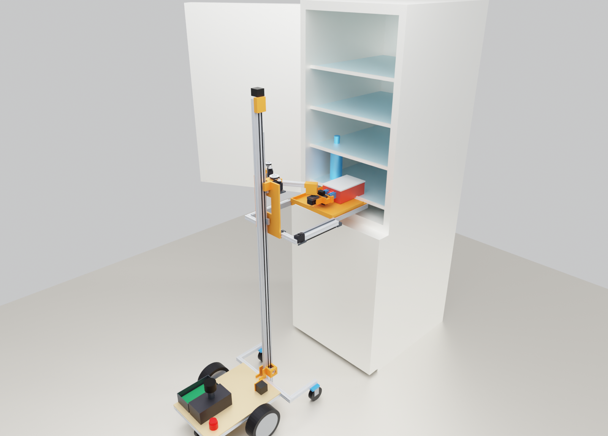
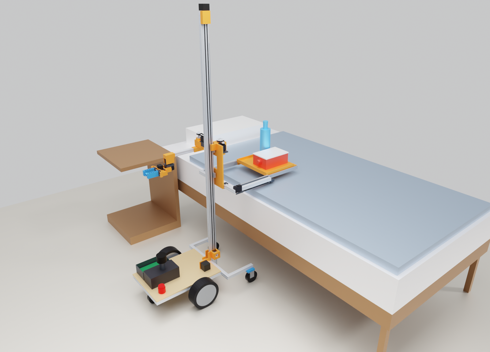

# Original mobile design: v0.2 and v0.3

The first mobile design of the project, drawn and simulated in October 2026. Nothing has been built or measured: every number below comes from the CAD, the closed-form checks in `calc.py` or the MuJoCo simulations. Code paths and commands are relative to the repository root.

## What it is

A mobile base with a vertical lift. The lift carries three things together:

- **a tray that is also a drawer**: 250 × 280 mm, slides out 240 mm on full-extension slides
- **two flat SCARA arms**, 2 × 220 mm links each, shoulders 240 mm apart; their links turn about vertical axes
- **on each wrist** yaw, pitch and roll, then the CAP gripper (angular two-finger jaw) with a phone on top

| Subsystem | Choice | Why |
|---|---|---|
| Base | Two hoverboard hub motors (flashed with FOC firmware), mid-wheel drive, straddle legs with casters in front | Direct drive, so nearly silent. Turns on the spot. The legs move the tipping line forward (see `calc.py`) |
| Lift | 2040 mast, MGN12 rail, NEMA17 + TMC2209 through a 3:1 GT2 belt | Same parts as a 3D printer, so it is quiet. ~130 mm/s max, run at 60 |
| Tray / drawer | Printed tray on 250 mm slides, driven by one STS3215 | Heavy things are dragged across, never lifted. Then the drawer pulls them in |
| Arms | Shoulder and elbow are STS3215 servos behind 3:1 and 2:1 belt reductions, on 6000 bearings; shoulders on a 2040 beam. Wrist yaw and roll STS3215, pitch STS3250, direct | The links never hold the arm up against gravity: the servos only move it sideways, so small servos are enough and can go limp when idle. The wrist does carry the hand (~1.3 N·m with 0.3 kg held) |
| Hands | The CAP robot gripper (NYU, printed from its published files, its own Dynamixel XL330), angular jaws ~90 mm open, a phone in landscape on top | The open pretrained skills were learned with exactly this hand and phone position |
| Senses | A phone on each wrist (a LiDAR phone, or any phone with depth from two views, see [cameras](cameras.md)), a phone as face and head camera, an RPLIDAR C1 for navigation | Lidar works in a dark room; a lamp lights the scene for the cameras |
| Compute | Off-board over USB, later Wi-Fi. An ESP32 on the robot runs the servo bus, lift, drive and e-stop | If Wi-Fi drops, the ESP32 stops everything locally |

Design values (v0.2): ~16 kg without payload. Tray height 0.075–1.54 m. Fingertips reach the floor and up to ~1.58 m. Footprint 445 mm wide, turning circle ~0.88 m at tray height.

## v0.2 and v0.3

**v0.2** changed the single-arm v0 after simulation:
- **Two arms**, a wrist roll, an **STS3250** on the wrist pitch.
- **CAP robot gripper + phone** on each wrist, so it can run the open, pretrained pick/open/close skills. The pretrained pick skill works as well on our kinematics as on an ideal gripper ([experiments/cap_zero_shot](../experiments/cap_zero_shot/README.md)).
- **1.8 m mast**, **spring balancer** and a **power-off brake** on the lift ([power-and-safety](power-and-safety.md)).
- Drive axle 12 cm forward; a face on the carriage; a lamp on top; a **self-charging dock** ([base-and-dock](base-and-dock.md)).
- Fridge door: one arm only opens doors that stay put above ~35°; two arms opened every door type tried, including tall doors and doors that close themselves. A policy *learned* from demonstrations opens 82% of 60 new random fridges with two arms, 12% with one ([two-arms](two-arms.md), [fridge-door](fridge-door.md)).
- Jars are not a reason for the second arm.
- A phone camera is enough for the first tests if the tapped point is triangulated from two wrist views ([cameras](cameras.md)).

**v0.3** is a proposal on top of v0.2; the CAD is still v0.2, with the v0.3 models in `cad/v03.py`, `render/test_videos.py` and `calc_v03.py` (stability per configuration).
- **The left arm becomes a "stump":** shoulder, elbow, one wrist yaw servo and a printed hook/fork/pad head. In the door simulation it opens 54/54 doors against 36/54 for a second full hand ([asymmetric-arms](asymmetric-arms.md)).
- **An infrared camera replaces the phone** on the hand, in a printed phone-shaped insert ([ir-camera](ir-camera.md)).

## The fridge → bed sequence (simulated; v0, re-run on v0.2)

On v0.2 the same run still ends with the box fully on the tray, and no actuator reaches its limit.
- Boxes of 0.8–2.0 kg, friction ≤ 0.5, all transfer.
- The long CAP hand needed three changes to the script:
  - unfold before driving up to the fridge, because the hand hit the fridge wall when unfolding beside it;
  - after the pull, leave the box to the left, because the wrist ends up beside its own shoulder;
  - park the hands hanging down beside the carriage, clear of the tray and a bed edge.

The numbers below are from v0.



1. Drive to the open fridge. Raise the tray to shelf height. Slide the drawer out to the shelf edge.
2. The hand grips the box's knob and drags it across onto the drawer. The box is never lifted.
3. The hand moves out to the side. The drawer slides back in, carrying the box.
4. Lower the tray, drive to the bed, slide the drawer out over the mattress.



`sim/demo.py` runs this open-loop in MuJoCo. Every actuator's force or torque is capped at the real spec-sheet peak, after the belt reductions. Results:

- 0.8 kg box: every joint stays under 23% of its limit.
- Up to 2.0 kg (friction up to 0.5): the box ends fully on the tray. Peak elbow torque is ~1.9 N·m, which is about the elbow's *rated* (continuous) torque.
- At 2.5 kg and above, the contact model goes numerically unstable when the box drops from the shelf onto the tray, so the simulation makes no statement above 2 kg.

The recorded run (2× speed) is `out/demo.mp4`, generated locally by `sim/demo.py --video`; videos are not in git. `out/demo_strip.png` is the frame strip.

**Fridge door** (`sim/door.py`, `sim/door_fig.py`). Hinged 8 kg door with a magnetic-seal model, self-closing below 85°, hold-open beyond 92°. Base force capped at wheel traction.
- The robot grips the handle with the arm nearly straight, backs off 5 cm, then follows the arc.
- The seal breaks whenever it is weaker than the traction: ~30 / 45 / 60 N at floor friction 0.4 / 0.6 / 0.8.
- The door then opens to 100° with arm loads at 10–40% of the servo limits.
- The base needs ~83 cm of floor sideways toward the hinge side, and the simulated base slides sideways, which two wheels cannot. Without that floor the door only reaches ~56° and closes again.
- Fixes: a second arm, or a seal-release pusher on the fridge. See [fridge-door](fridge-door.md).

**Robustness** (`sim/robustness.py`). 100 random trials of the box transfer. Each one randomises:
- box placement ±2.5 cm / ±3 cm / ±8°;
- weight 0.2–2 kg, friction 0.25–0.55;
- camera error 4 mm / 2°, tray height ±4 mm;
- servo stiffness 50–100%, ±1° joint zero error.

Results:
- v0, open loop: 87%.
- v0, with a camera check after the pull and up to two re-grasps: **96%**. Boxes over 1.5 kg: 25/28.
- **v0.2** (long CAP hand, real joint speeds), closed loop, 60 trials: **93%** (56/60). Boxes over 1.5 kg: 18/21.
  - Two fixes were needed: the pull target was still in v0 coordinates, and the hand must leave far to the left, or its phone hits the box when the drawer comes in.
- Failures: heavy boxes tilting at the drawer edge, and missed grips.

A learned policy exists for the fridge door ([two-arms](two-arms.md)); the box transfer is scripted.

**Why the drawer exists.** A fixed tray has a geometric problem: a hand pulling a box straight back always ends up between the box and the robot. The hand plus box is longer than any tray that fits on the robot, so the arm alone can never land a box fully on its own tray. Making the tray slide out fixes that.

## Design limits

- **Fridge door.** Simulation at real joint speeds: the seal must pull ≤ ~45 N at the handle.
  - One arm opens doors that stay where they are left above ~35°.
  - Two arms also open doors that close themselves, fridge-freezer or tall, and can hold them open.
  - Otherwise a small add-on opener.
  - [fridge-door](fridge-door.md). Real seal forces are unknown: measure with a luggage scale, and let the door go at 30/45/60°.
- **Lifting with the gripper.** v0.2's hand is long (pitch axis to grasp centre 276 mm): ~0.3 kg held continuously at rated STS3250 torque, ~1 kg in short peaks. Heavier things are slid across, never lifted.
- **The long hand needs room.** It is ~15 cm tall with the phone on top. Fridge compartments lower than that need the wrist rolled 90° (phone to the side). Parked, the hands hang beside the tray, so the tray must be ≥ 0.3 m high while driving.
- **Thresholds.** ~15 mm with 100 mm casters. No stairs.
- **Tall fridges.** With the 1.5 m mast the top shelf of a fridge-freezer (>1.3 m) is out of reach; v0.2's 1.8 m mast reaches ~1.58 m.
- **Shelf lips.** The simulated fridge has flush shelves. A raised lip at the shelf front will stop a heavy box from sliding.
- **Lift on power loss.** A belt lift falls when power is lost.
  - The spring balancer carries only the carriage's own weight.
  - With a parcel on the tray and the coils shorted it would creep down at ~5 mm/s.
  - So the lift motor has a 24 V power-off brake (0.4 N·m → 188 N; 3× what a 5 kg parcel needs) ([power-and-safety](power-and-safety.md)).
- **Driving with a high, loaded tray.** Keep the tray low while driving.

## Repo

```
params.py            all dimensions/masses (one source of truth)
calc.py              torque, lift, threshold, tipping, battery checks  -> prints a report
calc_v03.py          stability per configuration for v0.3
figs.py              out/heights.png
cad/robot.py         parametric CAD (build123d), one function per link
cad/scene.py         fridge/bed/floor props and poses
cad/build.py         -> print/*.stl, out/tischlein_v0_2.step, out/scene_*.glb
cad/v03.py           v0.3 models: stump arm, drawer tongue
cad/ir_camera.py     the infrared-camera insert -> print/ir_cam_insert.stl
render/              Blender renders (render_all.sh), looks (variants.py), test videos
sim/build_mjcf.py    MuJoCo model from the CAD (real actuator limits)
sim/demo.py          scripted fridge -> bed run, stress test (--stress), video
sim/door.py          fridge door opening sweep, holding the handle (--follow, --video)
sim/fridge_door.py   one arm vs two arms vs stump, real joint speeds, robot collision shapes, two door types, self-closing
sim/door_policy.py   behaviour cloning of the door skill from demos (collect / train / eval), one vs two arms
sim/jar.py           screw-top jar: one arm, one arm + clamp, two arms
sim/floor_pick.py    floor pick-up: grasp vs scoop
sim/actuators.py     servo and stepper models: jerk, backlash, hunting
sim/robustness.py    Monte Carlo of the box transfer (N trials, --open-loop)
sim/transfer_compare.py  transfer-strategy comparison
experiments/         pretrained CAP skills on Tischlein's kinematics in EgoGym (needs third_party/EgoGym)
bom.csv              parts by subsystem
vendor/so-arm100/    STS3215 STEP model from TheRobotStudio/SO-ARM100 (servo pockets are built from it)
```

```bash
uv sync --locked
uv run python calc.py && uv run python cad/build.py && uv run python sim/build_mjcf.py && uv run python sim/demo.py
```

Open `out/tischlein_v0_2.step` in Fusion 360/FreeCAD/Onshape to look around or to remodel a part.

## Notes

- [fridge-door.md](fridge-door.md): door simulation, and what to measure on a real fridge
- [two-arms.md](two-arms.md): one arm vs two: doors, jars, and a learned door policy
- [asymmetric-arms.md](asymmetric-arms.md): a hand and a stump vs two hands vs one arm, four archetypes in the door simulation
- [ir-camera.md](ir-camera.md): an infrared camera instead of the phone: where its lens must sit, tolerances, the printed insert
- [cameras.md](cameras.md): how accurate the tapped contact point must be, and what two-view triangulation achieves
- [power-and-safety.md](power-and-safety.md): lift brake, wiring and fuses
- [base-and-dock.md](base-and-dock.md): the base frame, what lives in the base, the charging dock
- [simulation-notes.md](simulation-notes.md): modelling pitfalls from the original experiments
- [experiments/cap_zero_shot](../experiments/cap_zero_shot/README.md): pretrained skills on Tischlein's kinematics, in EgoGym
