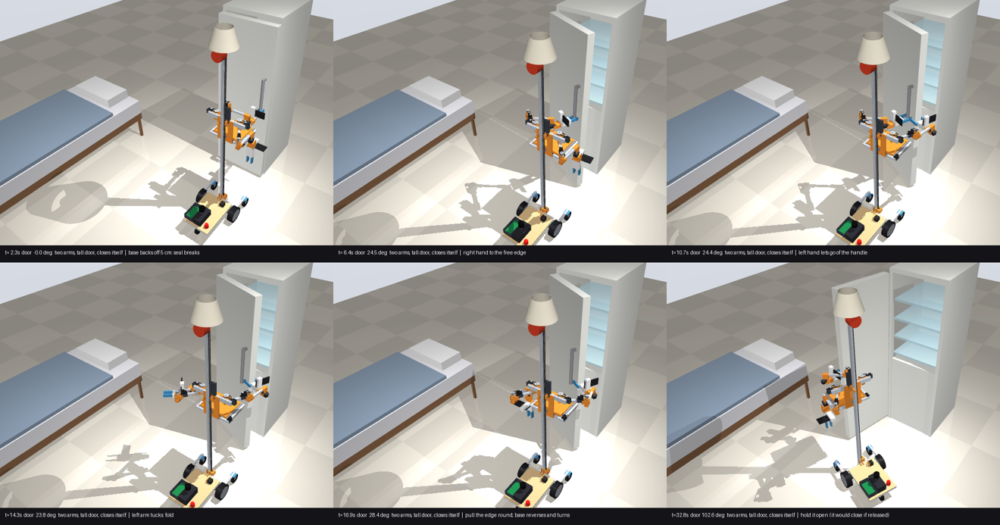

# Is the second arm worth it?

One-armed people manage almost everything, so does a second arm make the robot *substantially* better, or is it nice-to-have? This page answers it with simulations of the v0.2 robot: real joint speeds and torque limits, the robot's own collision shapes, and the CAP hands. Plus one learned policy instead of only scripted motions.

## Short answer

**A second arm matters mainly for doors, not for jars.**

| Task | One arm | Two arms | Evidence |
|---|---|---|---|
| **Fridge door that stays put above ~35°** | opens it | opens it | `sim/fridge_door.py`, 6/9 each (the 3 failures are the 55 N seal, for both) |
| **Fridge door that closes itself** (from 60°, or always: self-closing hinges) | **0 of 36 runs** | opens it **and holds it open** (24 of 36: all but the 55 N seal) | same sweep, fridge-freezer and tall door |
| Fetch from a door that won't stay open | impossible: the only hand must hold the door | left hand holds the door at 95–105°; the right reaches the lower shelf front from ~1,300–1,900 base poses | geometric check (reach + clearance), not physics |
| **Learned** door policy, 60 new random fridges | **12%** (none of the 47 self-closing doors) | **82%** (scripted teacher: 97%) | `sim/door_policy.py` |
| Screw-top jar | jar spins on the table: 0/15 | re-closed jars (≤ 0.6 N·m) yes, sealed jars (≥ 1 N·m) no | `sim/jar.py` |
| Screw-top jar, one arm **+ a jar clamp** | ≤ 1 N·m yes, ≥ 1.5 N·m no | | `sim/jar.py` |
| Towel folding, bags, dressing, two-handed carrying | no | yes, with own demonstrations (no pretrained two-hand skills exist for us) | judgement |

## Doors: why one arm loses

A fridge door is pulled open by the handle, but past ~40° the handle faces away from a robot standing in front. So the hand has to let go and take the door's free edge instead ([fridge-door.md](fridge-door.md)).
- **One arm:**
  - Between letting go and hooking the edge, the hand swings round the door edge with the robot backing off. That's several seconds even perfectly timed (the shoulder turns ~60°/s through its belt; the hand is 28 cm long with a phone sticking out sideways).
  - A door that closes itself from where it was let go is shut in ~1.3 s.
  - The handle can't be pulled past ~40–45° from the robot's side (tried: the robot runs into the door).
  - So one arm opens only doors that stay put above ~35°.
- **Two arms:**
  - The left hand stays on the handle while the right hand hooks the free edge. Nothing is ever released, so the door's self-closing doesn't matter.
  - For doors without hold-open, the robot can keep holding it and still has a hand free.
- No source gives how common each kind of door is. Many fridge hinges close the door only in its last 20–30°; cabinet hinges and some fridges close it from anywhere. **To classify a real fridge: open it to 30°, 45°, 60°, let go, watch.**

**What the simulation taught about two arms on one carriage:**
- **They work in the same horizontal planes, so they can't cross.** The idle arm must *tuck*: upper arm back along its side, forearm forward, hand hanging beside the carriage. CAD's `park` pose (elbow 35 cm in front of the shoulder) blocks the other arm's work space. The tuck is `TUCK_A` / `TUCK_B` in `cad/scene.py`; the door sim uses it.
- **Left object, left hand; right object, right hand.** The hand-over works because the handle is left of the free edge at ~25°.
- **The phone on the hand sticks out 11.5 cm to one side.** A hanging hand must point it outboard, or it lands on the tray.
- **The wrist yaw (STS3215) touches its limit** for 1–2 s when pulling a heavy 10 kg tall door by its edge: the 28 cm hand is a lever. An STS3250 on the yaw too would add margin.

## Jars: the second arm is not the answer

`sim/jar.py`: 80 mm jar on a table. The right hand grips the lid from the side and turns it in 60° strokes, rotating about the lid's axis (the flat arm can do that). Squeeze per finger 10–30 N: the CAP gripper's real squeeze isn't published, so that's the unknown.

| Lid torque | one arm | one arm + clamp | two arms |
|---|---|---|---|
| 0.3 N·m | jar spins | opens | opens |
| 0.6 N·m (opened, re-closed jar) | jar spins | opens | opens if squeeze ≥ 20 N |
| 1.0 N·m | jar spins | opens if squeeze ≥ 20 N | **holding hand slips** |
| ≥ 1.5 N·m (factory-sealed) | jar spins | lid slips in the hand | holding hand slips |

- The second hand holds the jar by friction, exactly like the twisting hand holds the lid. With the same small gripper it slips at about the same torque.
- A clamp on the tray holds better than a second CAP hand.
- For sealed jars neither works: that needs a stronger grip (a different gripper on one arm, or a jar-opener tool).

## A learned policy, not only scripts

`sim/door_policy.py` trains a policy instead of scripting the motions:
- **Demonstrations:** the scripted planner opens the door on random fridges: door type, self-closing behaviour, seal 10–45 N, floor, door mass ±25%, and the robot parked ±3 cm / ±4° off its plan. Only successful demos are kept, the standard rule for behaviour cloning.
- **Policy:** a small MLP that sees only what the robot can measure (noisy door angle from the camera, the fridge's position from its tag, its own joints) and outputs a 1 s chunk of joint targets (ACT-style action chunking with temporal ensembling).
- **Test:** the same 60 new random fridges for every row.

Result (`out/door_policy_eval.txt`; success = door ≥ 88° at the end, held if it closes itself):

| Arms | Controller | All 60 | stays put > 25° (13) | closes from 60° (31) | always closes (16) | fridge-freezer (27) | tall door (33) |
|---|---|---:|---:|---:|---:|---:|---:|
| one | scripted planner | 11 (18%) | 11 | 0 | 0 | 4 | 7 |
| one | **learned** | **7 (12%)** | 7 | 0 | 0 | 2 | 5 |
| two | scripted planner | 58 (97%) | 13 | 29 | 16 | 27 | 31 |
| two | **learned** | **49 (82%)** | 10 | 24 | 15 | 24 | 25 |

- **The learned two-arm policy opens 82% of random fridges; the learned one-arm policy 12%.**
  - The gap is physical, not a training artefact: no one-arm controller, scripted or learned, opened any of the 47 doors that close themselves.
  - On doors that stay put, one arm is about as good as two (scripted 11/13 vs 13/13).
- **Learning cost ~15 points against its own teacher** (49 vs 58). That's the usual behaviour-cloning gap with 116 demos, no data augmentation beyond input noise, and a plain MLP. More demos or a better policy class (diffusion, a small transformer) would close part of it.
- **Training data:**
  - one arm: 35 successful demos of 120 tries (all on doors that stay put);
  - two arms: 116 of 120;
  - 400 epochs on a laptop CPU, ~10 minutes each.
- **Limits:** state inputs, not images, and a simulated fridge. This shows the skill is learnable from demonstrations at this scale and keeps its two-arm advantage. It doesn't show the real robot will do it. On the robot the same recipe would take on the order of 100 teleoperated demonstrations.
