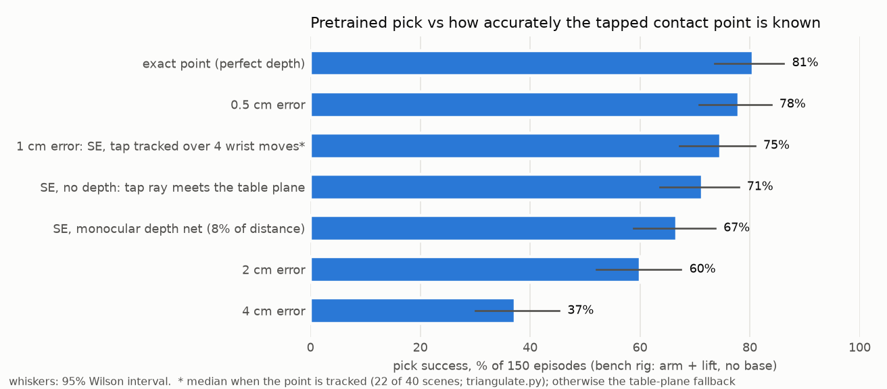
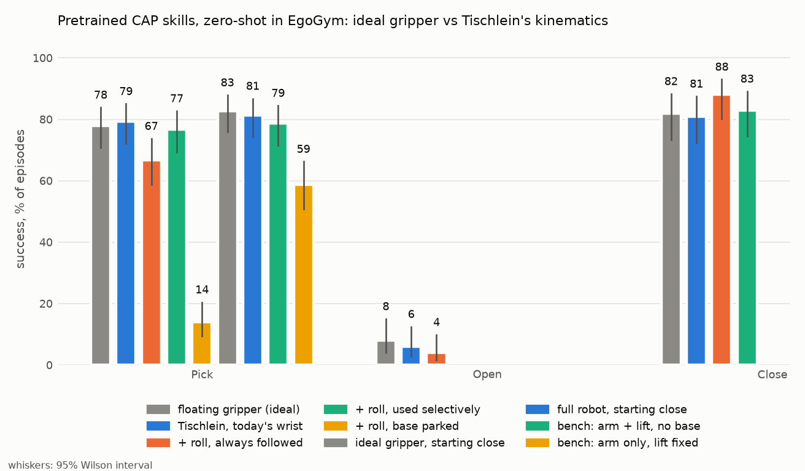

# Can Tischlein run pretrained skills it was never trained on?

The question: take the best open simulation and try our robot there. Is there a real chance that our sparse hardware can run pretrained skills?

## Setup

- **Policies:** CAP Pick / Open / Close checkpoints ([paper](https://arxiv.org/abs/2602.09017), [code](https://github.com/jeffacce/cap-policy), MIT). They were trained only on people holding a printed gripper with an iPhone, in real homes, and never saw any robot. On a real Stretch robot in unseen homes they reached 83% pick, 81% open and 96% close.
- **Simulator:** [EgoGym](https://github.com/omarrayyann/EgoGym) (MuJoCo, runs on a Mac), the CAP authors' own benchmark. Their 250 real runs vs 5,000 EgoGym episodes "suggest strong alignment". Each episode randomises objects (82 categories, ~2,500 models), textures, and procedural cabinets and drawers.
- **Embodiments**, all carrying the same CAP gripper and phone:

| Name | What |
|---|---|
| `cap` | EgoGym's floating gripper: goes wherever the policy says. The ceiling |
| `tisch5` | Tischlein as designed: diff-drive base, lift 0.075–1.24 m, SCARA 2 × 220 mm, wrist yaw + pitch |
| `tisch6` | the same + a wrist roll servo |
| `tisch6sel` | `tisch6`, but the roll joint stays near 0 unless the policy asks for a clear turn |
| `tisch6fixed` | `tisch6` with the base parked as close as the table allows and frozen during the motion (pick only) |
| `capnear`, `tisch6near`, `benchlift`, `benchnolift` | bench-rig comparison, see below |

- **How the robot is imposed** (`tischlein_cap.py`): every pose the policy commands goes through a whole-body IK first. The gripper is placed where the robot can actually put it, so the policy sees the consequences in its camera.
  - The IK has the joint limits, and per-step limits of 3 cm lift, 5 cm / 5° base and 25° arm per policy step.
  - The base may drive along its heading and turn, never slide sideways (v2 got this wrong after a turn; fixed in v3).
  - The mast and tray must not run into the table or cabinet front. The tray may pass above a table top.
  - The base is parked square to the furniture, in line with the target, far enough back to reach the start pose.
- **Not modelled:** link dynamics, link-vs-object collisions (v3 checks elbow and wrist against the table top and cabinet front only), servo slop, and the camera seeing our own arm. It's a kinematic filter between the policy and an ideal gripper, not a simulation of our arm.

```bash
cd third_party && git clone https://github.com/omarrayyann/EgoGym && cd EgoGym
uv venv --python 3.12 .venv && uv pip install --python .venv/bin/python mujoco gymnasium opencv-python scipy torch torchvision timm transformers accelerate hydra-core einops pandas matplotlib absl-py tqdm pillow gdown imageio && uv pip install --python .venv/bin/python -e . --no-deps
# checkpoints (README of EgoGym) into third_party/EgoGym/checkpoints/{pick,open,close}.pt; objects download on first use (3.5 GB)
cd ../.. && experiments/cap_zero_shot/run_all.sh
```

## Results

### v3: diff-drive fix, link checks, and how accurate the tapped point must be

v2 had a bug: the base's translation followed its *initial* heading even after it had turned, so it could slide sideways relative to its wheels.
- **Fixed:** each step's translation now goes along the mid-step heading.
- **New:** the elbow and wrist must stay above a table top they reach over, and in front of a cabinet front.
- **Re-run (`results/*_v3.json`, `run_v3.sh`, `run_v3b.sh`):**

| Task | Embodiment | v2 | v3 |
|---|---|---:|---:|
| pick | Tischlein, today's wrist | 79% | **79%** |
| pick | + roll, always followed | 67% | **67%** |
| pick | + roll, used selectively | 77% | **77%** |
| pick | + roll, base parked | 21% | **14%** |
| pick | full robot, starting close | 84% | **81%** |
| pick | bench: arm + lift, no base | 80% | **79%** |
| pick | bench: arm only, lift fixed | 62% | **59%** |
| close | Tischlein, today's wrist | 84% | **81%** |
| close | + roll, always followed | 86% | **88%** |
| close | + roll, used selectively | 87% | **83%** |
| open | Tischlein, today's wrist | 6% | **6%** |

All within the 95% intervals of v2 (±6–8 points). The base turns little during these skills, so the bug didn't change any conclusion. The parked-base case got worse (21 → 14%) because the new link check keeps the elbow off the table. The ideal grippers (`cap`, `capnear`) have no base; their v3 files are copies of v2. `tisch6`, `tisch6fixed` and the open runs were repeated by `run_v3b.sh`.

**How accurate must the tapped contact point be?** This is the question of how the contact point is obtained ([docs/cameras.md](../../docs/cameras.md)).
- The policy gets the contact point as a fixed world point plus an error, the way a real robot has it: deprojected once, then tracked by its own kinematics. EgoGym instead follows the object's true pose every step.
- `run_eval.py --anchor`, bench rig, 150 episodes each:



| Contact point | Pick |
|---|---:|
| exact, fixed in the world | 81% |
| 0.5 cm error | 78% |
| 1 cm error (≈ the SE's tracked triangulation, when the point is tracked: `triangulate.py`) | 75% |
| no depth: the tap's ray meets the table plane (+2 cm) | 71% |
| monocular depth, 8% of the distance along the ray | 67% |
| 2 cm error | 60% |
| 4 cm error | 37% |

### v2

Run `v2`: per-step limits as the real servos allow (shoulder 45°, elbow 60°, wrist 90° per 0.5 s step). Episodes are paired: the same seed gives the same objects and start noise for every embodiment.

| Task | Embodiment | Success | 95% CI | Episodes | Mean IK position error | Episodes with IK error > 2 cm | Mean IK angle error |
|---|---|---:|---:|---:|---:|---:|---:|
| pick | floating gripper (ideal) | **78%** | 71–84% | 150 | — | — | — |
| pick | Tischlein, today's wrist | **79%** | 71–84% | 150 | 0.3 cm | 35% | 1.4° |
| pick | + roll, always followed | **67%** | 59–74% | 150 | 0.2 cm | 38% | 0.9° |
| pick | + roll, used selectively | **77%** | 70–83% | 150 | 0.2 cm | 33% | 1.1° |
| pick | + roll, base parked | **21%** | 15–28% | 150 | 0.6 cm | 100% | 3.9° |
| open | floating gripper (ideal) | **8%** | 4–15% | 100 | — | — | — |
| open | Tischlein, today's wrist | **6%** | 3–12% | 100 | 0.5 cm | 72% | 2.0° |
| open | + roll, always followed | **5%** | 2–11% | 100 | 0.6 cm | 78% | 1.8° |
| close | floating gripper (ideal) | **82%** | 73–88% | 100 | — | — | — |
| close | Tischlein, today's wrist | **84%** | 76–90% | 100 | 1.0 cm | 82% | 1.6° |
| close | + roll, always followed | **86%** | 78–91% | 100 | 1.1 cm | 83% | 1.2° |
| close | + roll, used selectively | **87%** | 79–92% | 100 | 0.9 cm | 83% | 1.3° |

*IK error > 2 cm* counts episodes where the target was out of reach in at least one step, typically because the base (5 cm/step) or the lift (3 cm/step) couldn't keep up. The means stay ≤1 cm. Open was run once, with an earlier, stricter step limit (25° for every joint); it is at the floor anyway.



What it says:
- **Pick and close: Tischlein's kinematics cost nothing measurable.** Today's wrist: 79% pick and 84% close, vs 78% and 82% on the ideal floating gripper.
  - The IK tracking error is small, and failures are the policy's own: thin, flat things such as plates, spatulas and cutlery fail on the ideal gripper too.
- **A wrist roll must be used selectively.** If the roll joint chases every small roll the policy asks for, pick drops to 67%.
  - Paired comparison: 25 episodes won by the roll-less wrist and lost with roll, 8 the other way round. Not noise.
  - The cause shows in replays. At full stretch, at the table edge, the flat arm is at its straight-elbow singularity. There the IK spins the roll joint (−5° → −50°) and the camera view drifts.
  - Keeping the roll near 0 unless a clear turn is requested (as for horizontal handles): 77% pick, 87% close, back at the ideal level.
  - That's a controller choice, not a hardware problem.
- **The base has to move during the reach.** Parked as close as the table allows and frozen there, pick drops to 21%.
  - Part of that comes from EgoGym's start view not being reachable from the parking spot. Most of it is reach: the policy expects to keep advancing.
  - Stretch, which CAP was deployed on, also drives its base during skills. Our controller must treat "base forward/back + turn" as joints. Diff drive can do that; the hoverboard hall sensors give ~6 mm resolution, so the base moves coarse and the arm moves fine.
- **Open can't be judged here.** The policy reaches only 5–8% in EgoGym on every embodiment, including the ideal one.
  - The frames show it closing early and then "opening" with nothing in hand; continuous grasping and longer episodes didn't help.
  - The CAP paper reports EgoGym numbers only for pick; on a real Stretch it opened 81%.
  - So for opening, the case for the roll joint rests on the human demonstrations below.
- **Not shown by this:** servo slop, the real phone camera, lighting, our own arm in the picture. That needs a bench test.

## Bench rig: can the arm be tested without the base, or without the lift?

Same pick task, but every run starts ~35 cm from the object, as on a bench, with the selective roll. 150 episodes each:

| Rig | Pick success |
|---|---:|
| Ideal floating gripper (`capnear`) | 83% |
| Full robot, base free to move (`tisch6near`) | 84% |
| **Arm + lift on a stand, no base** (`benchlift`) | **80%** |
| Arm on a stand, lift fixed at the start height (`benchnolift`) | 62% |

Read as:
- **Starting close, the base adds nothing**, so the first bench test doesn't need it.
- **The lift matters:** without it, every up/down move has to come from tilting the wrist, which costs 18 points.
- **So a first bench test needs the arm and the lift, not the base.**

The bench runs and the second `tisch6near` run used the v0.2 geometry (axle shifted, 1.8 m mast); the IK only depends on relative positions, so it is comparable to the rows above.

## Human demonstrations: how much do people roll the gripper?

From 338 real demonstrations in the CAP dataset (8 homes for Open, 4 for Close), we measured the rotation about the gripper's pointing axis relative to the start pose:

| Task | Median roll | Demos with >15° roll |
|---|---:|---:|
| Open (cabinets, drawers) | 89° | 63% |
| Close | 4° | 1% |

People turn the gripper a quarter turn for horizontal handles. A wrist without a roll joint can't copy that.
